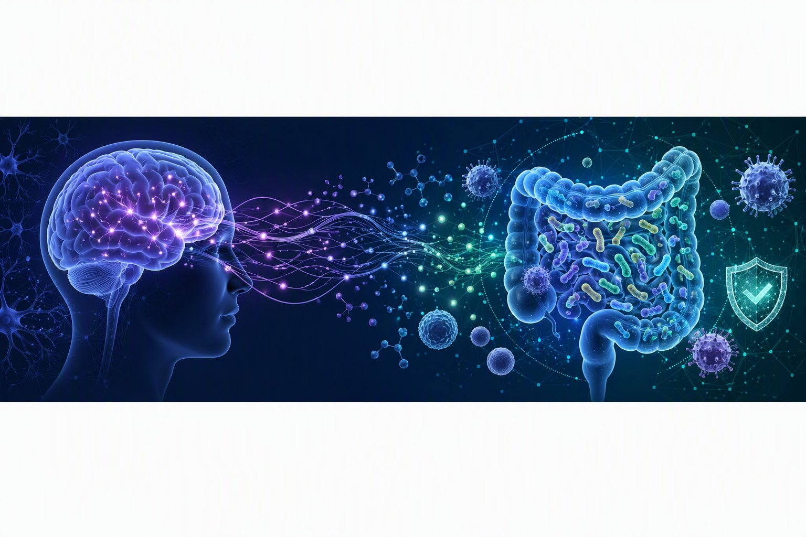

## Cryan Lab
Our lab is located at [APC Microbiome Ireland](https://www.ucc.ie/en/apc/) in University College Cork, Ireland. Our research is focused on understanding the interaction between brain, gut and microbiome and how it applies to stress, psychiatric and immune-related disorders at key time-windows across the lifespan. 

## Research Areas

- 🧠 Gut–brain communication
- 🦠 Gut microbiome
- 😌 Stress, anxiety and depression
- 💊 Psychobiotics
- 🧬 Neurodevelopment
- 🧪 Translational neuroscience

## Current Projects

- Microbiome and mental health
- Psychobiotic interventions
- Early-life stress
- Host–microbe interactions
- Multi-omics and computational biology
## Repositories
## Reproducibility

We are committed to **open and reproducible science**.

Where possible, repositories include:

- analysis scripts
- software environments
- workflow documentation
- example datasets or simulated data
- citation information

## Funding

Supported by:

- **APC Microbiome Ireland**
- **University College Cork**
- **Science Foundation Ireland**
- **European Research Council**

  
## Publications

Recent publications can be found on my [Google Scholar](https://scholar.google.com/cer=3SiQStcAAAAJ).

## Opportunities

We welcome enquiries from prospective PhD students, postdoctoral researchers and collaborators. Please contact Email: cryanlab@ucc.ie

## Connect

- 🌐 Lab website
- 🐦 Bluesky/X
- 📚 Google Scholar
